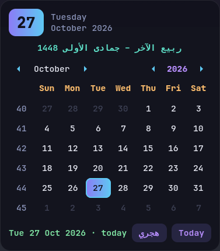
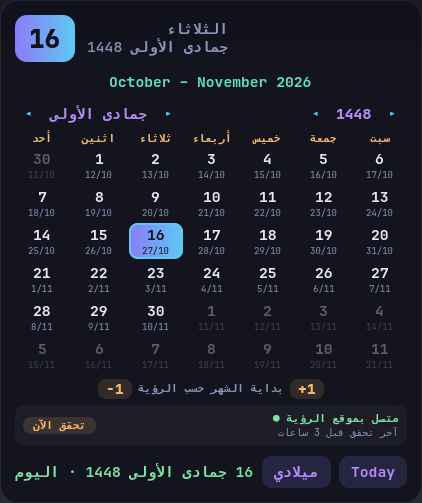
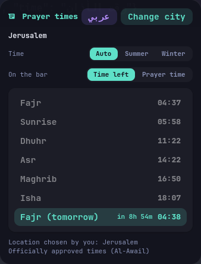
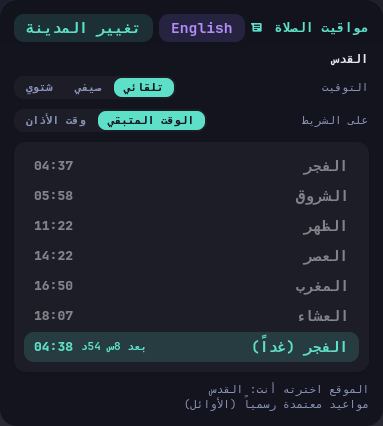

# Modern Islands

A colorful, glassy [Waybar](https://github.com/Alexays/Waybar) setup for Hyprland, with a built-in Gregorian and Hijri calendar and prayer times. The bar is split into three dark islands, and every module sits in its own tinted chip.


<p align="center">
  
  &nbsp;
  
</p>

## Features

### The bar

- **Workspaces:** 10 dots. The active one stretches into a violet-to-cyan pill, filled dots have windows, and rings are empty. Scroll to move between workspaces.
- **Center:** weather, the clock, a date chip, the next prayer with the time left, and the current media (artist and title, click to play or pause).
- **Right side:** CPU, memory, temperature, Bluetooth, network, brightness, keyboard layout, volume, battery, notifications, and power. Each one has its own color.

### Date chip and calendar popup

- **Date chip:** right-click switches between the **Gregorian** and **Hijri** (Umm al-Qura) date. Left-click opens the calendar popup. The tooltip shows both dates.
- **Calendar popup:** a GTK4 layer-shell panel styled like the bar, with two full calendars:
  - **Gregorian:** the GTK calendar with week numbers. A line above it shows which Hijri months the visible month covers.
  - **Hijri:** its own month grid with Hijri month and year navigation. Each day also shows its Gregorian date, and a line above shows which Gregorian months the Hijri month covers.
  - The footer shows the selected date and how many days it is from today.

| Key | Action |
|---|---|
| Scroll | previous / next month |
| Shift+Scroll, PageUp / PageDown | previous / next year |
| Arrow keys | move by one day |
| `T` | jump to today |
| `H` | switch Hijri / Gregorian (the bar follows) |
| `Esc` or click outside | close |

### Prayer times

<p align="center">
  
  &nbsp;
  
</p>

**The chip** shows the next prayer and how long is left, for example `Asr in 1h 12m` (in Arabic `العصر بعد 1س 12د`), or the adhan time instead, for example `Asr 14:22`. In the last 15 minutes it turns amber. Hover over it to see all of today's times, click it to open the prayer popup, and right-click to refresh.

**The popup** shows your place as *City - Country* (for example `Amman - Jordan`), and today's times: prayers that have passed are dimmed, and the next one is highlighted with a countdown. The last lines show how the place was chosen, the place again, and where the times come from. Changes to the settings below show up at once, in the popup and on the bar, without closing the popup. It also has:

- **Change city:** type the name of your city in Arabic or English and pick it from the list (places are searched on [OpenStreetMap](https://nominatim.openstreetmap.org)). The Arabic and English names of the city are both saved, so the city and the country are always shown in the same language. Cities with officially approved times are listed first and marked **approved times**. The times download right away. **Automatic** under the search goes back to finding your location from your IP address.
- **Auto / Summer / Winter:** *Auto* follows your system clock, so the times move by an hour when the clocks change. *Summer* and *Winter* force one or the other, like the buttons on the Al-Awail website. This helps when your clock and your local summer time don't change on the same day.
- **Time left / Prayer time:** chooses what the chip shows next to the prayer name.
- **عربي / English:** switches the language of the popup, the chip and its tooltip, including the city and country names. In Arabic the popup is laid out right to left.
- **Where the times come from:** the last line of the popup (and of the tooltip) says it:

| Line | Meaning |
|---|---|
| Officially approved times (Al-Awail) | from the city's approved times page, the same as the Al-Awail phone app |
| Al-Awail, adjusted to this week's approved times | the calculator, shifted by the difference seen in the approved week (usually within a minute) |
| Al-Awail calculator | the website's calculator; your city has no approved times page |
| Calculated on this computer | al-awail.com isn't answering, so the times are calculated locally |

#### Where the times come from

- **Al-Awail:** the times come from [Al-Awail](https://al-awail.com), the company behind the prayer clocks in many mosques. Its website has no API, so the script reads the same pages a browser would.
- **Officially approved times:** for some cities (for example Jerusalem, Nablus, Ramallah and Hebron), Al-Awail publishes the times approved by the Ministry of Awqaf on [al-awail.com/prayers](https://www.al-awail.com/prayers/). These match the Al-Awail phone app and mosque clocks. The page only shows the current week, so it is read at most twice a day, and every day seen is kept. Days after that week use the calculator, shifted by the difference seen in the approved week.
- **Calculator:** for any other place, the script asks the website's calculator for a whole year at once. After that it works offline. Everything is saved in `~/.cache/prayer-times`.
- **When the site is down:** if al-awail.com doesn't answer and nothing is saved for your place yet, the times are calculated on your computer with the same method. Checked against a full Al-Awail year, they match to the minute on most days and are never more than 2 minutes off (only Fajr, on a couple of days). The script tries the site again every 10 minutes and switches back as soon as it answers.
- **Location:** found from your IP address and checked again every 6 hours. IP location is only accurate to the nearest city, sometimes only the region, so choosing your city in the popup is better.

#### Settings file

The popup saves its settings in `~/.config/prayer-times.json`. You can also edit it by hand (every key is optional):

```json
{"city": "Nablus", "latitude": 32.2211, "longitude": 35.2544,
 "lang": "ar", "chip": "left", "dst": "auto", "method": 2, "hanafi": false,
 "offsets": {"Fajr": -2, "Isha": 3}}
```

| Key | Meaning |
|---|---|
| `city`, `latitude`, `longitude` | your place; with these set, the IP lookup is turned off |
| `city_ar`, `city_en`, `country` | the city's Arabic and English names and the country code; filled in when you choose a city |
| `lang` | `"ar"` for Arabic, anything else for English |
| `chip` | `"left"` shows the time left on the chip, `"time"` the adhan time |
| `dst` | `"auto"`, `"summer"` or `"winter"` |
| `method` | calculator method: `0` Karachi, `1` ISNA, `2` Muslim World League (default), `3` Umm al-Qura, `4` Egyptian, `5` Diyanet |
| `hanafi` | `true` uses the Hanafi Asr time |
| `offsets` | minutes added to single prayers, to match your mosque exactly |

From a terminal: `scripts/prayer_times.py show` prints today's times, `refresh` downloads again, and `lang` switches the language.

### Moon sighting

The Hijri date is calculated offline with the Umm al-Qura calendar. Months that really start a day earlier or later, after the crescent is sighted, are handled in two ways:

- **Automatic check:** around the end of each Hijri month (day 28 to day 2), an invisible module asks the [AlAdhan API](https://aladhan.com/islamic-calendar-api) once an hour. If the month was announced as 30 days instead of 29, or started a day late, the bar and the calendar follow the announcement. If the site can't be reached, it waits 6 hours before trying again.
- **Connection status:** under the Hijri grid, a line shows whether the last check reached the site (green) or failed (red), and when. Hover over it to see the error, or press the check button to try again right away. The date chip tooltip shows the same line.
- **Manual correction:** if your region announces a different start, or the API can't be reached from your network, use the `-1` / `+1` buttons under the Hijri grid to move the first day of the month shown. The bar follows it, and the automatic check leaves that month alone.

The Hijri labels in the popup are in Arabic.

## Requirements

Tested on Arch Linux with Hyprland 0.56 and Waybar 0.15.

| Needed for | Packages (Arch names) |
|---|---|
| bar | `waybar`, `ttf-jetbrains-mono-nerd` |
| calendar and prayer popups | `python`, `python-gobject`, `gtk4`, `gtk4-layer-shell` |
| Hijri date | `icu` (already installed on almost every system) |
| click actions | `playerctl`, `brightnessctl`, `wireplumber`, `pavucontrol`, `blueman`, `network-manager-applet`, `swaync`, `btop`, `kitty`, and `wlogout` (AUR) |

```sh
sudo pacman -S --needed waybar ttf-jetbrains-mono-nerd python-gobject gtk4 gtk4-layer-shell icu \
    playerctl brightnessctl wireplumber pavucontrol blueman network-manager-applet swaync btop kitty
yay -S wlogout   # or any AUR helper
```

The Hijri conversion calls the system ICU library through `ctypes`, so no pip packages are needed. The click actions are optional: the bar works without them, only that click does nothing.

## Install

```sh
git clone https://github.com/ahmad-salman322/waybar-modern-islands
cd waybar-modern-islands
./install.sh
```

The installer moves your current `~/.config/waybar` to `~/.config/waybar.bak-<date>`, copies the files in, and restarts Waybar.

If Waybar isn't started by your Hyprland config yet, add:

```
exec-once = waybar
```

### Uninstall

Remove the installed folder and move your backup back:

```sh
rm -rf ~/.config/waybar
mv ~/.config/waybar.bak-<date> ~/.config/waybar
```

## Files

```
config.jsonc               bar layout and module settings
style.css                  colors and styles
scripts/date_chip.py       the date chip (Gregorian / Hijri)
scripts/calendar_popup.py  the calendar popup
scripts/hijri.py           Gregorian <-> Hijri conversion, with sighting corrections
scripts/hijri_sync.py      the moon-sighting check
scripts/weather.py         weather from wttr.in
```

Sighting data is saved to `~/.cache/hijri-sync.json`, and the date chip mode to `~/.cache/datechip-mode`.

## Customize

- **Weather location:** it is detected from your IP by [wttr.in](https://wttr.in). To pin a city, set `WEATHER_LOCATION`, for example in `hyprland.conf`:
  ```
  env = WEATHER_LOCATION,Amman
  ```
- **Hijri source:** the default is AlAdhan's `HJCoSA` calendar (Umm al-Qura corrected by the Saudi High Judiciary Council's crescent sightings). To use another method, set `HIJRI_METHOD`, for example `env = HIJRI_METHOD,UAQ`. To check right now from a terminal, run:
  ```sh
  ~/.config/waybar/scripts/hijri_sync.py --force
  ```
- **Colors:** all colors are `@define-color` variables at the top of `style.css`.
- **Terminal:** `kitty` is used for `btop` and `nmtui`. Change it in `config.jsonc` if you use another terminal.
- **Floating islands:** to add a gap from the screen edges, add `"margin-top": 6, "margin-left": 10, "margin-right": 10` to `config.jsonc`.

## Privacy

Two outside services are contacted: wttr.in for the weather (every 30 minutes) and the AlAdhan API for the moon-sighting check (only around the end of each Hijri month). Nothing else leaves your machine.

## License

[MIT](LICENSE)
